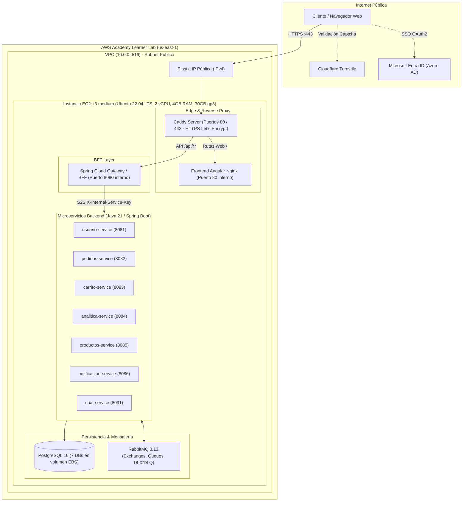

# Arquitectura Cloud y Presupuesto Económico — AWS Academy Learner Lab

## 1. Visión General y Restricciones de Presupuesto

Pedidos360 ha sido diseñado y optimizado para ejecutarse dentro del presupuesto estricto de **AWS Academy Learner Lab** (~$50 USD de crédito total en la región `us-east-1`).

Para garantizar la viabilidad técnica y financiera sin riesgo de agotar los créditos del laboratorio, se adoptó una arquitectura **Single-Host Hardened Container Cluster**:
- **Cero servicios administrados de alto costo:** Queda prohibido el uso de AWS EKS ($73/mes por plano de control), AWS NAT Gateway ($32.40/mes + tráfico), AWS ALB/NLB ($18+/mes) y AWS RDS ($25-$60+/mes).
- **Consolidación en una sola instancia EC2:** Todos los microservicios, el API Gateway / BFF, PostgreSQL 16, RabbitMQ 3.13 y el reverse proxy Caddy se ejecutan en contenedores Docker orquestados por Docker Compose.
- **Terminación TLS y Dominio Dinámico Gratuitos:** Caddy provee certificados SSL/TLS automáticos Let's Encrypt mediante resolución DNS comodín con `sslip.io` (`<ip-guiones>.sslip.io`).

---

## 2. Diagrama de Arquitectura de Infraestructura

---

## 3. Desglose Detallado de Costos Mensuales

| Componente AWS | Tipo / Configuración | Costo Unitario Estimado (us-east-1) | Costo Mensual Estimado | Justificación |
|---|---|---|---|---|
| **Cómputo EC2** | `t3.medium` (2 vCPU, 4 GiB RAM) | $0.0416 / hora | **$30.37 USD** | Capacidad suficiente para 8 microservicios Java 21 optimizados con SerialGC, Postgres y RabbitMQ. |
| **Almacenamiento EBS** | 30 GB `gp3` (3,000 IOPS, 125 MB/s) | $0.08 / GB-mes | **$2.40 USD** | Disco raíz encriptado para SO, binarios Docker y datos de PostgreSQL. |
| **Dirección IPv4 Pública** | 1 Elastic IP (asociada a EC2 activo) | $0.005 / hora (política AWS 2024) | **$3.60 USD** | IP estática requerida para DNS `sslip.io` y emisión de certificado Let's Encrypt. |
| **Transferencia de Datos (Egress)** | ~5 GB / mes hacia Internet | Primeros 100 GB/mes gratis (AWS Free Tier) | **$0.00 USD** | Tráfico HTTP de navegación y assets web comprimidos con gzip. |
| **Certificados TLS** | Let's Encrypt vía Caddy | Gratis / Open Source | **$0.00 USD** | Cero costo comparado con CloudFront o ACM asociado a ALB. |
| **Total Mensual Proyectado** | | | **~$36.37 USD** | **Margen de seguridad restante: ~$13.63 USD del voucher de $50 USD.** |

> [!TIP]
> **Modo Ahorro Extremo (Opcional):**
> Si el estudiante desea reducir el gasto a **~$18.00 USD/mes**, puede cambiar la instancia a `t3.small` (1 vCPU, 2 GiB RAM) aumentando el archivo de swap de Linux a 4GB en el script de arranque.

---

## 4. Estrategia de Asignación de Memoria por Contenedor (4 GB RAM)

En Linux EC2 con 4 GB de RAM física, cada contenedor tiene límites estrictos declarados en `docker-compose.ec2.yml`:

| Contenedor | mem_limit | mem_reservation | Flag JVM Clave |
|---|---|---|---|
| `postgres` | 512 MB | 256 MB | `shared_buffers = 128MB`, `max_connections = 60` |
| `rabbitmq` | 384 MB | 192 MB | `vm_memory_high_watermark.relative = 0.4` |
| `caddy` | 128 MB | 64 MB | Servidor Go ultraligero |
| `frontend` | 128 MB | 64 MB | Nginx Alpine sirviendo estáticos compilados |
| `bff` | 384 MB | 192 MB | `-XX:+UseSerialGC -XX:MaxRAMPercentage=70.0` |
| `usuario` | 384 MB | 192 MB | `-XX:+UseSerialGC -XX:MaxRAMPercentage=70.0` |
| `pedidos` | 384 MB | 192 MB | `-XX:+UseSerialGC -XX:MaxRAMPercentage=70.0` |
| `carrito` | 320 MB | 160 MB | `-XX:+UseSerialGC -XX:MaxRAMPercentage=70.0` |
| `productos` | 320 MB | 160 MB | `-XX:+UseSerialGC -XX:MaxRAMPercentage=70.0` |
| `analitica` | 320 MB | 160 MB | `-XX:+UseSerialGC -XX:MaxRAMPercentage=70.0` |
| `notificacion` | 288 MB | 144 MB | `-XX:+UseSerialGC -XX:MaxRAMPercentage=70.0` |
| `chat` | 320 MB | 160 MB | `-XX:+UseSerialGC -XX:MaxRAMPercentage=70.0` |
| **Total Reservado / Límite** | **~3,552 MB** | **~1,776 MB** | **Garantiza 500 MB libres para el Kernel Linux de Ubuntu.** |

